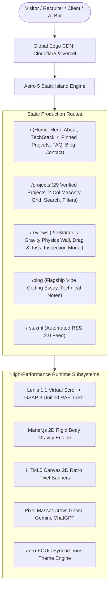
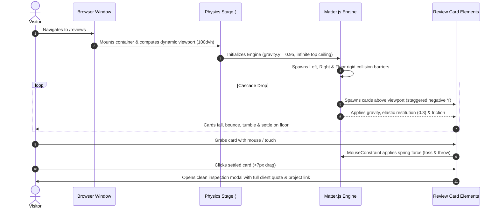
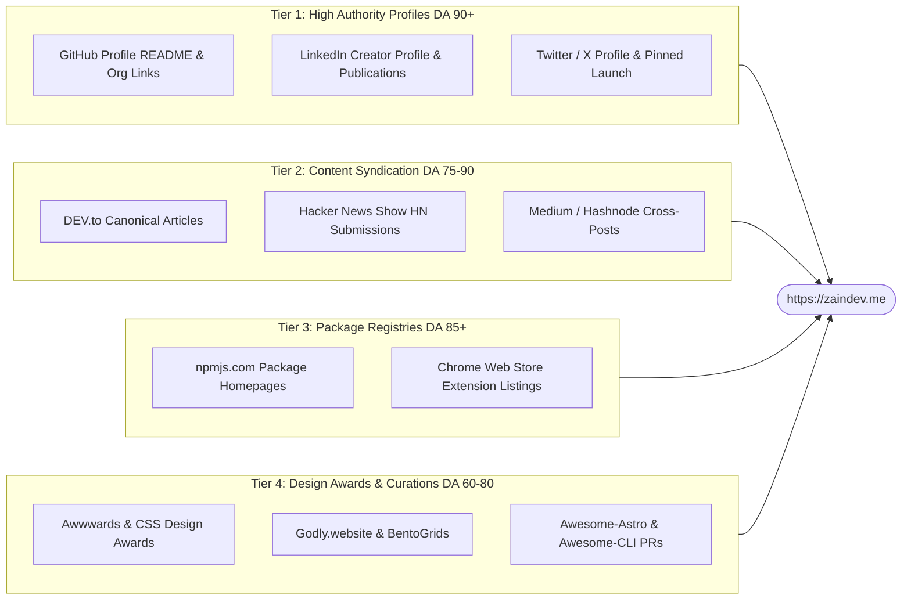

# Zain Ali Developer (`zaindev.me`) — Creative Engineering Portfolio

<div align="center">

```
███████╗ █████╗ ██╗███╗   ██╗    ██████╗ ███████╗██╗   ██╗
╚══███╔╝██╔══██╗██║████╗  ██║    ██╔══██╗██╔════╝██║   ██║
  ███╔╝ ███████║██║██╔██╗ ██║    ██║  ██║█████╗  ██║   ██║
 ███╔╝  ██╔══██║██║██║╚██╗██║    ██║  ██║██╔══╝  ╚██╗ ██╔╝
███████╗██║  ██║██║██║ ╚████║    ██████╔╝███████╗ ╚████╔╝ 
╚══════╝╚═╝  ╚═╝╚═╝╚═╝  ╚═══╝    ╚═════╝ ╚══════╝  ╚═══╝  
```

**Senior Full Stack Developer & Creative Technologist**  
*7+ Years Engineering Scalable Platforms, Manifest V3 Extensions, Developer Tooling & Motion WebGL Physics*

[](https://zaindev.me)
[](https://astro.build)
[](https://www.typescriptlang.org/)
[](https://brm.io/matter-js/)
[](https://greensock.com/)
[](https://zaindev.me)

</div>

---

## ⚡ Architectural Blueprint



---

## 🎮 Interactive 2D Physics Engine Sequence (`/reviews`)



---

## 🚀 Key Feature Matrix

| Feature | Engineering Architecture | User Experience Impact |
|---|---|---|
| **2D Physics Wall** | [Matter.js](https://brm.io/matter-js/) + DOM transform sync (`translate3d` + `rotate`) | Cards drop from an infinite ceiling, bounce off boundaries, drag & toss with tactile momentum. |
| **2-Column Masonry** | CSS Grid `repeat(2, 1fr)` + dynamic JS search & filter chips | Clean non-collapsing 2-column layout displaying 29 verified projects with zero empty space. |
| **Strict 4-Card Home** | Hand-curated pinned highlights: SaaS (`flux`), Open Source (`ani-skills`), Extension (`stack-ray`), Creative (`sadia-graphics`) | Prevents cognitive overload on home while routing recruiters to deep work. |
| **Vibe Coding Essay** | Astro Content Collections + Markdown + TechArticle Schema | Authoritative essay ranking for AI-first software development and prompt loop architectures. |
| **Multiplayer Loader** | Custom Canvas Cursor simulation (`CursorBuildLoader.astro`) | Playful opening ceremony drawing site layout with Figma-style selection bounding boxes. |
| **Zero-FOUC Dark Mode** | Synchronous `<head>` theme script guard with `data-theme` | Instant paint without a single frame of white flash on dark theme users. |
| **B&W Minimal Favicon** | Resolution-independent SVG vector path (`/favicon.svg`) | Sharp, bold geometric "Z" icon on pitch-black background. |

---

## 📦 Verified Projects Catalogue (29 Active Works)

### 🎨 Creative & Client Engineering (16 Projects)
1. **Sadia Aqeel Brand Studio**: Luxury visual identity portfolio engineered with Lenis smooth scrolling & GSAP timelines.
2. **Aversano's Restaurant**: Commercial Italian restaurant platform with responsive online ordering and table booking.
3. **Ayesha WordPress Portfolio**: Kinetic portfolio featuring bold typography and GSAP scroll-triggered text animations.
4. **Zain Dark Motion Portfolio**: Next.js portfolio with interactive dark visuals, Anime.js physics, and Lenis scroll.
5. **NRN Media Agency**: Ultra-fast media agency showcase optimized for 100/100 Core Web Vitals.
6. **Alan Kitchen Accessories**: Lightweight eCommerce showroom with fluid micro-interactions.
7. **Flower Canvas**: Pure HTML5 Canvas interactive particle experiment generating blooming procedural flowers.
8. **Scatter Dots Canvas**: Interactive physics particle scatter canvas responding to cursor proximity and URL query states.
9. **Text Drawing Canvas**: Real-time vector calligraphy and particle text generator on HTML5 Canvas.
10. **WallFly Wallpaper Hub**: High-performance wallpaper gallery platform with instant search and download pipelines.
11. **Froger Meme Generator**: Client-side meme generator with live typography controls and instant canvas export.
12. **CC Goku Creative Developer**: Anime-inspired minimalist dark/light portfolio with dynamic shaders.
13. **Neo-Brutalist Portfolio**: High-contrast brutalist design system featuring raw typography and hard drop-shadows.
14. **Ultimate Empire**: Commercial web platform engineered with sub-second page transitions.
15. **Mughal Dev Showcase**: Motion-driven experimental portfolio featuring WebGL shaders.
16. **VibeSpace 3D**: Three.js WebGL spatial experience with interactive 3D camera controls.

### 🛠️ Open Source, Tooling & Extensions (13 Projects)
1. **Flux Application**: Real-time agile project management workspace with WebSockets and Supabase state synchronization.
2. **StackRay Extension**: Manifest V3 Chrome extension integrating local on-device Gemini Nano AI.
3. **ani-skills (npm)**: Published npm package enabling high-speed agentic code workflows for modern developers.
4. **e-git-zain (npm)**: Global CLI wrapper automating branch hygiene and pre-commit secret leak detection.
5. **Terminal Manager**: GPU-accelerated cross-platform terminal workspace and AI agent execution environment.
6. **Zest Keyboard App**: Desktop productivity utility turning 2-key combos into instant desktop commands.
7. **Vibe Inspector**: Chrome extension enabling visual element inspection directly synced to disk code editing.
8. **Quirk GitHub**: Open-source query builder helping security researchers audit public repos for exposed tokens.
9. **Pookie Bot**: Multi-device WhatsApp automation engine with modular plugins.
10. **FastCLI Scaffolder**: CLI generator bootstrapping production full-stack apps in seconds.
11. **DevPulse**: Browser extension tracking active developer productivity metrics.
12. **OmniChat AI**: Multi-model unified LLM client interface.
13. **Pixelated Retro Matrix Portfolio**: Monochromatic retro portfolio engineered with Astro 4 and 120fps magnetic grid canvas.

---

## 🌐 The Backlink Acquisition & SEO Dominance Playbook

To rank **#1 on Google** for your brand name (`"Zain Ali Developer"`, `"zainalidev"`, `"Zain Ali Mughal"`) and capture high-intent developer keywords, follow this battle-tested 4-tier backlink acquisition strategy:



### Actionable Implementation Steps:

1. **Package Registry Backlinks (Highest DA Dofollow Links)**:
   - In your published npm packages (`ani-skills`, `e-git-zain`), set `package.json`:
     ```json
     "homepage": "https://zaindev.me",
     "author": "Zain Ali Mughal <me@zaindev.me> (https://zaindev.me)"
     ```
   - In `manifest.json` for `StackRay`, specify `homepage_url: "https://zaindev.me"`.
   - Every npm package page on `npmjs.com` and Chrome Web Store listing grants a high-authority `dofollow` backlink that Google indexes instantly.

2. **Cross-Platform Canonical Syndication**:
   - Cross-publish the flagship essay *"What is Vibe Coding?"* to **DEV.to**, **Medium**, and **Hashnode**.
   - Always specify the canonical tag: `canonical_url: https://zaindev.me/blog/what-is-vibe-coding`.
   - This prevents duplicate content penalties while channeling 100% of the external readership and link equity straight into `zaindev.me`.

3. **Community Launches (Hacker News & Product Hunt)**:
   - **Show HN**: Submit *"Show HN: Zest – 2-key hotkey workflow engine for engineers"* $\rightarrow$ Link to `https://zest-soon.vercel.app` & `https://zaindev.me`.
   - **Show HN**: Submit *"Show HN: Interactive 2D gravity physics portfolio built with Astro 5 & Matter.js"* $\rightarrow$ Link to `https://zaindev.me/reviews`.
   - **Product Hunt**: Launch `Zest` and `StackRay` with your maker profile linking to `https://zaindev.me`.

4. **Curated Showcase & Directory Submissions**:
   - Submit `https://zaindev.me` to:
     - [Godly.website](https://godly.website/) (Top tier creative design gallery)
     - [BentoGrids](https://bentogrids.com/) (Featured bento UI gallery)
     - [Minimal Gallery](https://minimal.gallery/)
     - [Land-book](https://land-book.com/)
     - [Awwwards](https://www.awwwards.com/) & [CSSDA](https://www.cssdesignawards.com/)
   - Submit PRs to GitHub Awesome Lists:
     - `awesome-astro` (under Showcase)
     - `awesome-browser-extensions` (StackRay)
     - `awesome-cli` (Terminal-Manager & e-git-zain)

---

## 🔮 Future Engineering Roadmap

- [ ] **Developer Command Palette (`Ctrl + K` / `Cmd + K`)**: Keyboard-driven launcher to search projects, switch themes, navigate sections, and run simulated CLI terminal commands.
- [ ] **Live Interactive Canvas Playgrounds**: In-page modal preview runner for Canvas experiments (*Flower Canvas*, *Scatter Dots*, *Text Drawing*) allowing recruiters to play with particles without leaving the tab.
- [ ] **Live Telemetry & API Badges**: Client-side cached fetchers displaying real-time npm downloads for `e-git-zain` and `ani-skills`, plus live GitHub star counters.
- [ ] **Deep-Dive Technical Case Studies**:
  - *Case Study 1*: Engineering a Manifest V3 Extension with Local On-Device Gemini Nano AI (StackRay).
  - *Case Study 2*: Building a Production Git Wrapper with Pre-Commit Secret Scanning (e-git-zain).
  - *Case Study 3*: Real-Time WebSockets State Synchronization in Next.js & Supabase (Flux).

---

## 🛠️ Local Development & Scripts

```bash
# Clone the repository
git clone https://github.com/usernamezain/Portfolio-2026.git
cd Portfolio-2026

# Install dependencies
npm install

# Start local development server (with hot reload)
npm run dev

# Run full TypeScript & Astro type checking
npm run check

# Compile production-ready static output into /dist
npm run build

# Preview the compiled production build locally
npm run preview
```

---

## 📄 License
MIT © [Zain Ali Mughal (zainalidev)](https://zaindev.me)
