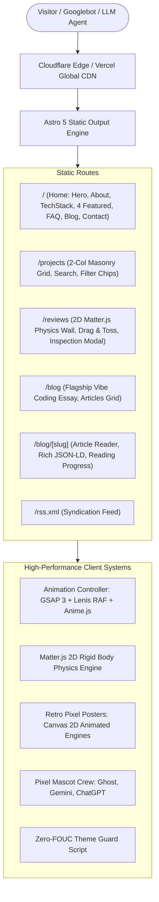

# Project Context & Architecture — zaindev.me

> **Canonical Domain**: [https://zaindev.me](https://zaindev.me)  
> **Brand & Moniker**: Zain Ali Developer (`zainalidev` / Zain Ali Mughal)  
> **Repository**: [https://github.com/usernamezain/Portfolio-2026](https://github.com/usernamezain/Portfolio-2026)  
> **Core Engine**: Astro 5 (Static Island Architecture), GSAP 3, Matter.js, Anime.js, Lenis, TypeScript

---

## 1. System Architecture Overview



---

## 2. Directory Structure & File Map

```
Personal-Portfolio/
├── .agent/                    # Antigravity agent skills & workflows
├── public/                    # Static public assets
│   ├── icons/                 # High-resolution tech stack SVGs
│   ├── favicon.svg            # Minimalist B&W geometric "Z" icon
│   ├── og-image.png / .svg    # 1200x630 OpenGraph social previews
│   ├── robots.txt             # Search & AI crawler directives (GPTBot, ClaudeBot)
│   ├── site.webmanifest       # PWA web manifest
│   ├── llms.txt               # LLM context summary for AI search engines
│   └── llms-full.txt          # Unrestricted canonical LLM documentation
├── src/
│   ├── assets/images/         # Optimized WebP/SVG project mockups (29 active)
│   ├── components/
│   │   ├── common/            # Badge.astro, Icon.astro
│   │   ├── layout/            # Header.astro (Nav + Theme toggle), Footer.astro
│   │   ├── media/             # Avatar, ProjectMedia, Pixel Posters
│   │   ├── motion/            # CursorBuildLoader.astro (multiplayer cursor intro)
│   │   ├── sections/          # Hero, About, TechStack, Projects, FaqKnowledge, Blog, Contact
│   │   └── seo/               # SEO.astro (Complete meta suite + Google verification)
│   ├── content/
│   │   └── blog/              # Markdown articles (what-is-vibe-coding.md)
│   ├── data/
│   │   ├── portfolio.ts       # 29 verified projects data & technical specs
│   │   ├── reviews.ts         # 9 verified client testimonials & avatar images
│   │   └── seo.ts             # Global JSON-LD Schema.org graph & SEO configs
│   ├── layouts/
│   │   └── Layout.astro       # Root HTML shell, theme guard, skip links, progress bar
│   ├── pages/
│   │   ├── index.astro        # Home page (4 pinned featured cards)
│   │   ├── projects/          # Dedicated 29-project showcase with search/filters
│   │   ├── reviews/           # 2D physics gravity card wall (Matter.js)
│   │   ├── blog/              # Technical writing & essays
│   │   └── rss.xml.ts         # Automated RSS syndication feed
│   ├── scripts/               # Animation controller, Matter.js runner, pixel engines
│   └── styles/                # global.css (Design tokens, dark/light themes, typography)
├── astro.config.mjs           # Astro configuration (Sitemap, CSS bundling, Vite chunks)
├── package.json               # Dependencies & scripts
└── tsconfig.json              # Strict TypeScript configuration
```

---

## 3. Active Production Routes

| Route | Purpose & Key Features | Primary SEO Keywords |
|---|---|---|
| `/` | Flagship personal landing page with animated pixel hero, interactive tech stack, 4 selected cards, FAQ accordion with direct review link. | `"Zain Ali Developer"`, `"zainalidev"`, `"who is zainalidev"` |
| `/projects` | Complete catalogue of 29 real projects in a responsive 2-column grid with live search, category filtering, and direct links to live apps & GitHub repositories. | `"Zain Ali projects"`, `"Full stack developer portfolio"` |
| `/reviews` | Interactive 2D gravity physics testimonial wall powered by Matter.js. Cards fall from an infinite top ceiling, bounce, drag & toss, and open clean inspection modals. | `"What clients said"`, `"Zain Ali reviews"`, `"client testimonials"` |
| `/blog` | Engineering writing hub featuring the flagship 2026 essay *"What is Vibe Coding? The AI-First Software Engineering Revolution"*. | `"what is vibe coding"`, `"vibe coding guide"`, `"ai engineer portfolio"` |
| `/blog/[slug]` | Clean typography reading experience with reading progress bar and `TechArticle` structured data schema. | Post-specific technical tags |
| `/rss.xml` | Fully compliant RSS 2.0 / Atom feed for syndication. | N/A (Feed reader autodiscovery) |

---

## 4. Pinned Home Projects (Strict 4-Card Allocation)

1. **Backend / SaaS**: `flux-app` — High-performance real-time agile workspace with WebSockets & Supabase.
2. **Open Source**: `ani-skills` — Published npm package for high-speed agentic code workflows.
3. **Chrome Extension**: `stack-ray` — Manifest V3 browser utility with local Gemini Nano AI.
4. **Creative Technologist**: `sadia-graphics` — Luxury editorial brand portfolio with Lenis & GSAP kinetic motion.

---

## 5. SEO & Google Search Console Integration

- **Google Verification Tag**: `<meta name="google-site-verification" content="LgIcNOIfdlS1XmPkAtDASQhnnhKfvkFVzMEEiOngZxk" />`
- **Canonical Domain**: `https://zaindev.me` across all pages, breadcrumbs, sitemaps, and feeds.
- **Rich Structured Data (`generateStructuredData`)**:
  - `Person`: Identifies Zain Ali Mughal, alternative aliases (`zainalidev`, `Mughal Dev`), occupations, skills, and verified social profiles.
  - `WebSite`: Configures site search action and publisher.
  - `ProfilePage`: Targets personal name search queries.
  - `FAQPage`: Explicitly answers identity and hiring questions for Google Rich Sitelinks & Knowledge Graph.
  - `TechArticle`: Rich snippets for blog essays.
- **Crawler Directives (`robots.txt`)**: Full index authorization for Googlebot, Bingbot, and frontier AI agents (`GPTBot`, `ClaudeBot`, `PerplexityBot`).
- **AI Search Optimization**: `public/llms.txt` and `public/llms-full.txt` structured per the `llmstxt.org` specification.

---

## 6. Comprehensive Backlink Acquisition Master Plan

To build high Domain Authority (DA) and secure **#1 Google Search Ranking** for your name and developer keywords, follow this prioritized backlink roadmap:

```mermaid
flowchart TD
    Tier1["Tier 1: High-Authority Developer Profiles (DA 90+)"]
    Tier2["Tier 2: Content Syndication & Community (DA 70-90)"]
    Tier3["Tier 3: Design & Portfolio Recognition (DA 60-80)"]
    Tier4["Tier 4: Open Source & Ecosystem (DA 80+)"]

    Tier1 --> P1["GitHub Profile README + Organization Links"]
    Tier1 --> P2["LinkedIn Profile, Featured Section & Publications"]
    Tier1 --> P3["Twitter / X Profile & Pinned Project Showcase"]
    
    Tier2 --> C1["DEV.to Articles with Canonical Link to zaindev.me"]
    Tier2 --> C2["Hashnode Blog mapped to zaindev.me"]
    Tier2 --> C3["Medium Cross-Posts with rel=canonical"]
    Tier2 --> C4["Show HN: Hacker News launches for Zest & StackRay"]

    Tier3 --> D1["Submit to Awwwards / CSS Design Awards"]
    Tier3 --> D2["Submit to Godly.website, Bentogrids, MinimalGallery"]
    Tier3 --> D3["Product Hunt Launch for Zest Keyboard & Vibe Inspector"]

    Tier4 --> O1["npm Packages (ani-skills, e-git-zain) homepage field"]
    Tier4 --> O2["Chrome Web Store listing homepage for StackRay"]
    Tier4 --> O3["Curated Awesome-Lists on GitHub (awesome-astro, awesome-extension)"]
```



### Actionable Backlink Execution Checklist:

#### Phase 1: Direct Profile & Identity Links (Immediate)
- [ ] **GitHub Profile**: Update bio link to `https://zaindev.me`. In `usernamezain/usernamezain` profile README, link prominently to your portfolio, blog, and projects.
- [ ] **npm Packages**: In `package.json` for `ani-skills` and `e-git-zain`, ensure:
  ```json
  "homepage": "https://zaindev.me",
  "author": "Zain Ali Mughal <me@zaindev.me> (https://zaindev.me)"
  ```
  Every install and package page on `npmjs.com` creates a high-authority `dofollow` backlink!
- [ ] **LinkedIn**: Add `https://zaindev.me` to Contact Info, Featured link, and Creator Profile link.
- [ ] **Twitter / X**: Set website to `https://zaindev.me`.

#### Phase 2: Technical Content Syndication (High Leverage)
- [ ] **DEV.to & Hashnode**: Publish *"What is Vibe Coding?"* on DEV.to. Set the `canonical_url: https://zaindev.me/blog/what-is-vibe-coding`. This passes 100% SEO authority to your site while harvesting thousands of developer views.
- [ ] **Hacker News (Show HN)**:
  - Submit: *"Show HN: Zest – 2-key combo hotkey engine with zero context switching"* $\rightarrow$ links to `https://zest-soon.vercel.app` & `https://zaindev.me`.
  - Submit: *"Show HN: Interactive 2D gravity physics portfolio built with Astro 5 & Matter.js"* $\rightarrow$ links to `https://zaindev.me/reviews`.

#### Phase 3: Design Inspiration & Developer Directories
- [ ] **Portfolio Galleries**: Submit `https://zaindev.me` to:
  - [Godly.website](https://godly.website/)
  - [Minimal Gallery](https://minimal.gallery/)
  - [BentoGrids](https://bentogrids.com/)
  - [Land-book](https://land-book.com/)
  - [Awwwards](https://www.awwwards.com/) & [CSS Design Awards](https://www.cssdesignawards.com/)
- [ ] **Awesome Repositories**: Submit pull requests adding your tools:
  - `awesome-astro`: Add `zaindev.me` under Showcases.
  - `awesome-browser-extensions`: Add `StackRay`.
  - `awesome-cli`: Add `Terminal-Manager` and `e-git-zain`.

---

## 7. Future Engineering Roadmap

- [ ] **Interactive `Ctrl + K` Developer Command Palette**: Fast modal allowing visitors to search projects, switch themes, navigate routes, and run simulated CLI terminal commands.
- [ ] **Inline Interactive Canvas Playgrounds**: Modal preview runner for Canvas experiments (*Flower Canvas*, *Scatter Dots*, *Text Drawing*) without leaving the site.
- [ ] **Dynamic Live Telemetry**: Live npm download counters (`e-git-zain`, `ani-skills`) and real-time GitHub stars via client-side caching.
- [ ] **Expanded Technical Case Studies**:
  - Case Study 1: *Building a Manifest V3 Chrome Extension with Local Gemini Nano* (StackRay).
  - Case Study 2: *Building an All-In-One Git CLI Tool with Pre-Commit Secret Scanning* (e-git-zain).
  - Case Study 3: *Real-Time State & WebSockets with Supabase in Next.js* (Flux).
